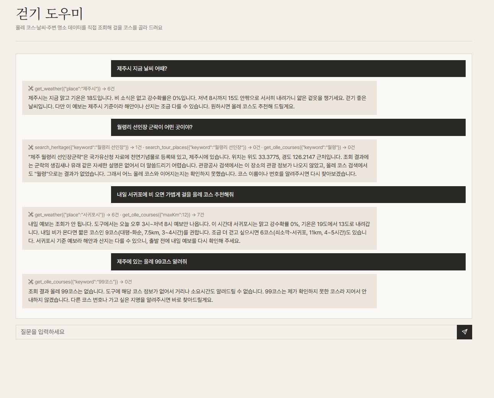

# 제주를 걷다 — 트레킹을 좋아하는 관광객을 위한 올레길 추천

> **오늘은 어디를 걸을까? 날씨를 보고 올레길 코스를 골라 드려요.**
> 제주올레 27개 코스를 지도·날씨·주변 명소와 함께 보여주고, AI 걷기 도우미가 공공데이터를 직접 조회해 오늘 걸을 코스를 추천하는 웹앱입니다.

제주대 청년도약 부트캠프 1기 · 2일 개별 과제 (제주 IP × 공공데이터 × AI 에이전트)

| | |
|---|---|
| **배포 주소** | **https://jejuip.vercel.app** |
| **GitHub** | https://github.com/eungyo9374-bit/jejuip |
| **QR 코드** |  |

---

## 1. 기획 의도

**누구를 위해** — 제주에서 걷기 여행을 하려는 관광객, 특히 처음 올레길을 걷는 사람.

**어떤 문제** — 올레길은 코스가 27개나 되고 거리(4~24km)와 소요시간(1~8시간)이 제각각이라, "오늘 내가 어디를 걸어야 하는지" 고르기가 어렵습니다. 게다가 걷기 여행은 **그날 날씨**에 따라 좋은 코스가 달라집니다.

**어떤 가치** — 코스 정보(거리·시간·시종점), 오늘의 걷기 날씨, 코스 주변 명소와 문화유산을 한 화면에 모으고, "내일 비 오면 가볍게 걸을 코스 추천해줘" 같은 질문에 AI가 **실제 공공데이터를 조회해서** 답합니다. 코스마다 제주의 특징(감귤·돌하르방·해녀·돌고래 등)을 손그림 마스코트로 그려 코스를 기억하기 쉽게 했습니다.

## 2. 주요 기능

| 화면 | 내용 |
|---|---|
| **홈** | 서비스 소개, 오늘의 날씨, 추천 코스·풍경 사진(10초마다 다른 코스로 전환), 시스템 점검 |
| **올레 지도** | 손그림 제주 지도 위에 27개 코스 선과 번호 배지. 코스를 누르면 해당 구간으로 확대 |
| **올레 코스** | 코스 카드 27개(A/B 갈래는 한 카드로 합침). 난이도(거리 기준)·권역 필터, 지명 검색 |
| **3D 지도** | 실제 고도로 만든 3D 제주(한라산 포함) 위에 코스 선과 번호. 코스를 누르면 카메라가 날아가고 주변 관광지·문화유산 핀이 나타남. **오늘 날씨가 비·눈이면 비·눈이 내리고**(구름·번개·물방울·한라산 눈 쌓임), 맑음·흐림·비·눈을 미리 볼 수 있음. 등고선·종이결의 손그림 풍 지형. 3D를 못 그리는 기기에서는 손그림 지도로 안내 |
| **코스 상세** | 해당 구간 확대 지도(출발·도착), 거리·소요시간, 오늘의 걷기 날씨와 6시간 예보, 주변 명소 사진, 주변 문화유산, 올레 수첩에 담기 |
| **걷기 도우미** | AI 에이전트. 올레·날씨·명소·문화유산 도구를 스스로 골라 호출하고, **호출한 도구 목록**을 화면에 보여줌 |
| **내 올레 수첩** | 코스·명소를 닉네임별로 저장(Supabase). 새로고침해도 유지, 중복 방지, 빼기(취소) 가능 |

## 3. 사용한 공공 API (4개)

모든 API는 **서버 함수(`/api/*`)** 를 거쳐 호출하므로 인증 키가 브라우저에 노출되지 않습니다.

| # | API | 제공처 | 이 서비스에서 하는 일 |
|---|---|---|---|
| ① | **제주특별자치도_올레코스현황** | 제주특별자치도 (공공데이터포털) | 코스 번호·이름·거리·소요시간·시종점 (27개 코스, 29행) |
| ② | **국문 관광정보 서비스 (TourAPI)** | 한국관광공사 | 코스 주변 관광지(좌표 기준 가까운 순)와 사진 |
| ③ | **단기예보 조회서비스** | 기상청 | 코스가 있는 지역(제주시·서귀포시 기준)의 오늘 걷기 날씨, 6시간 예보 |
| ④ | **국가유산 검색 오픈API** | 국가유산청 | 코스 주변(반경 약 8km) 문화유산을 가까운 순으로 |

그 밖의 데이터: 해안선과 실제 올레길 경로 일부는 **OpenStreetMap**(© OpenStreetMap contributors, ODbL) 기록을 사용했습니다.

## 4. AI 에이전트 (걷기 도우미)

**구조** — 에이전트 = LLM(두뇌) + 도구(공공 API 함수) + 반복 루프. 모델은 `claude-sonnet-5-5`이고, Claude 키는 서버(`/api/agent`)에서만 사용합니다.

| 도구 | 하는 일 |
|---|---|
| `get_olle_courses` | 올레 코스 조회 (번호·지명·최대 거리로 거르기) |
| `get_weather` | 제주시·서귀포시 날씨 |
| `search_tour_places` | 주변 관광지·문화시설·음식점 검색 |
| `search_heritage` | 국가유산 이름 검색 |

**안전장치** — 도구 호출 루프 최대 5회, 답변 길이 제한(`max_tokens`), 대화 기록 최근 10개만 전송, 시스템 지시문에 "도구 결과에 없는 장소는 지어내지 않는다", 오류 메시지는 화면에 안전한 문구만 노출(키 마스킹).

### 테스트 결과 (4개 질문)

> 에이전트가 고르는 도구와 순서는 질문마다, 실행할 때마다 조금씩 달라질 수 있습니다. (아래는 배포본에서 실제로 실행한 결과)

| # | 질문 | 에이전트가 호출한 도구 | 결과 |
|---|---|---|---|
| 1 | 제주시 지금 날씨 어때? | `get_weather` 1회 | 기상청 예보(맑음, 18℃, 강수확률 0%)로 답함 |
| 2 | 월령리 선인장 군락이 어떤 곳이야? | `search_heritage` · `search_tour_places` · `get_olle_courses` | 국가유산청에서 "제주 월령리 선인장군락(천연기념물)"을 찾아 답하고, 없는 정보는 "확인되지 않는다"고 밝힘 |
| 3 | 내일 서귀포에 비 오면 가볍게 걸을 만한 올레 코스 추천해줘 | `get_weather` → `get_olle_courses` (**도구 2개 연속**) | 서귀포 날씨와 12km 이하 코스를 조회해 9코스·6코스를 추천. 예보가 오늘치뿐이라 "내일 예보는 확인하지 못했다"고 정직하게 안내 |
| 4 | 제주에 있는 올레 99코스 알려줘 | `get_olle_courses` | "결과가 없다"고 답하고 **지어내지 않음** |

**실제 화면 캡처** (질문 4개, 에이전트가 호출한 도구 목록이 각 답변 위에 표시됨)

)을 풀어 주세요.

-->

## 5. 기술 구조

```
브라우저 (React 앱)
  router.jsx ─ RootLayout ─ pages/*       store/useAppStore.js (Zustand: 닉네임·알림·수첩·대화)
     │  fetch('/api/...')                    │  supabase.from('favorites')
     ▼                                       ▼
Vercel 서버 함수 /api/*                  Supabase (수첩 저장)
  olle · tour · weather · heritage  → 공공 API ①②③④   (인증 키는 여기에서만 사용)
  agent  → Claude + 위 도구들
```

- **스택**: Vite · React 19 · React Router 7 · Zustand · Bootstrap 5 · Supabase · Vercel 서버 함수 · Anthropic SDK
- **폴더**: `src/pages`(화면) · `src/components`(공용 부품) · `src/store`(전역 상태) · `src/api`(서버 호출) · `src/lib`·`src/data`(지도·코스 도우미와 데이터) · `api/`(서버 함수) · `server/`(화면과 에이전트가 함께 쓰는 API 호출 함수)
- 지도와 마스코트는 별도 라이브러리 없이 **SVG로 직접 그렸습니다**. 3D 지도는 Three.js(@react-three/fiber)로 만들었고, 3D 화면을 열 때만 코드를 불러옵니다(지연 로딩).

## 6. 실행 방법

```bash
npm install
cp .env.example .env.local        # Windows: copy .env.example .env.local
vercel dev                        # http://localhost:3000  (화면 + /api 서버 함수)
```

> `npm run dev`는 화면만 띄우고 `/api`를 실행하지 않습니다. 서버 함수에는 `.env`(서버용)도 필요합니다.

| 환경변수 | 용도 | 공개 여부 |
|---|---|---|
| `VITE_SUPABASE_URL`, `VITE_SUPABASE_ANON_KEY` | Supabase 연결 | 브라우저에 포함(공개 가능한 값) |
| `DATA_GO_KR_KEY` | 공공데이터포털 인증키(Decoding) | **서버 전용 비밀** |
| `ANTHROPIC_API_KEY` | Claude 키 | **서버 전용 비밀** |

**Supabase**: `supabase/favorites.sql`을 SQL Editor에서 실행하면 수첩 테이블과 정책(읽기·저장·삭제)이 만들어집니다.

## 7. 보안

- 비밀 키는 `.env`/`.env.local`(Git에 올리지 않음)과 Vercel 환경변수에만 있고, 브라우저 코드에는 들어가지 않습니다. (배포된 화면 코드에 키가 없는 것을 직접 확인)
- 에이전트 오류가 나도 키가 화면에 노출되지 않도록 안전한 문구만 내보냅니다.
- 올레 수첩 테이블의 정책은 **실습용(누구나 읽기·저장·삭제)** 입니다. 실제 서비스라면 Supabase Auth로 로그인한 사용자만 쓰게 바꿔야 합니다.

## 8. 알려진 한계 (솔직한 안내)

- **코스 경로선**: 공공데이터(올레코스현황)에는 경로 좌표가 없습니다. 그래서 **OpenStreetMap에 기록된 실제 올레길**을 10개 코스(1·2·5·8·10·11·16·18·19·20)에 적용하고, 나머지는 **해안선을 따라 그린 대략적인 선**입니다. 공식 경로가 아니며, 화면에도 그렇게 표시했습니다.
- **3D 지도**: 고도 격자가 약 0.28km 간격이라 큰 오름은 보이지만 작은 지형은 뭉개질 수 있습니다. 날씨 효과(구름·비·번개·눈 쌓임)는 분위기 연출이며 실제 강수량을 나타내지 않습니다. 높이는 보기 좋게 약 3.7배 과장했고, 추자도 코스는 3D에서 뺐습니다.
- **날씨**: 기상청 단기예보는 제주시·서귀포시 두 지역만 사용해서 해안·산지 날씨와 다를 수 있습니다. 예보는 오늘 몇 시간치만 가져옵니다.
- **난이도**는 데이터에 없어서 거리 기준(12km 이하 가볍게, 17km 이하 보통, 그 이상 도전)으로 직접 나눴습니다.
- **출발·도착 좌표**는 이어지는 코스의 끝점으로 보정했지만, 일부는 1~2km 오차가 있을 수 있습니다.

## 9. 출처와 라이선스

- 코스 정보: 제주특별자치도 올레코스현황 / 관광 정보·사진: 한국관광공사 / 예보: 기상청 / 문화유산: 국가유산청 (이상 공공데이터포털 이용)
- 해안선·올레길 경로 일부: © OpenStreetMap contributors (Open Database License)
- 3D 지형 고도: AWS Open Data **Terrain Tiles** (Mapzen 제작, SRTM·GMTED2010·ETOPO1 등 공개 자료 기반). 한 번 받아 약 0.28km 간격 격자로 줄여 `src/data/jeju-terrain.json`에 저장
- 글꼴: Noto Serif KR, Pretendard, Cormorant Garamond, Gaegu (모두 오픈 라이선스)
- 마스코트·지도 일러스트: 이 프로젝트에서 직접 그린 SVG
